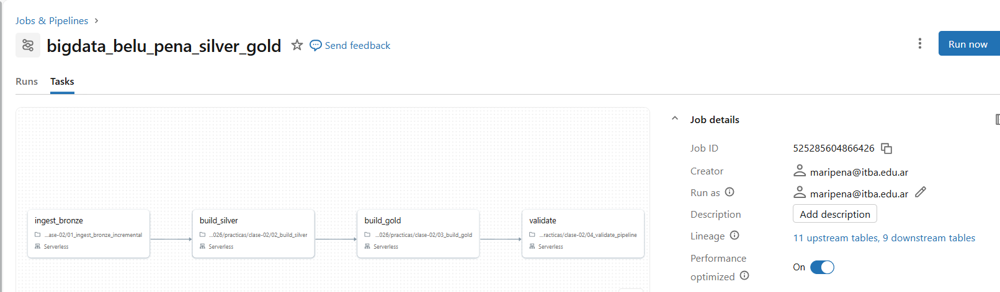
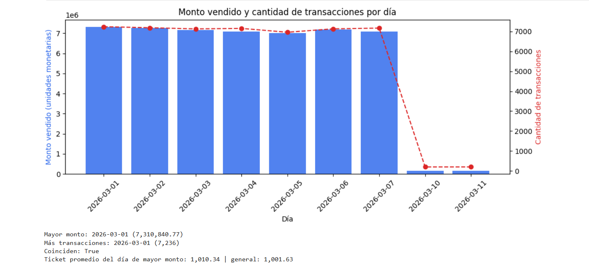
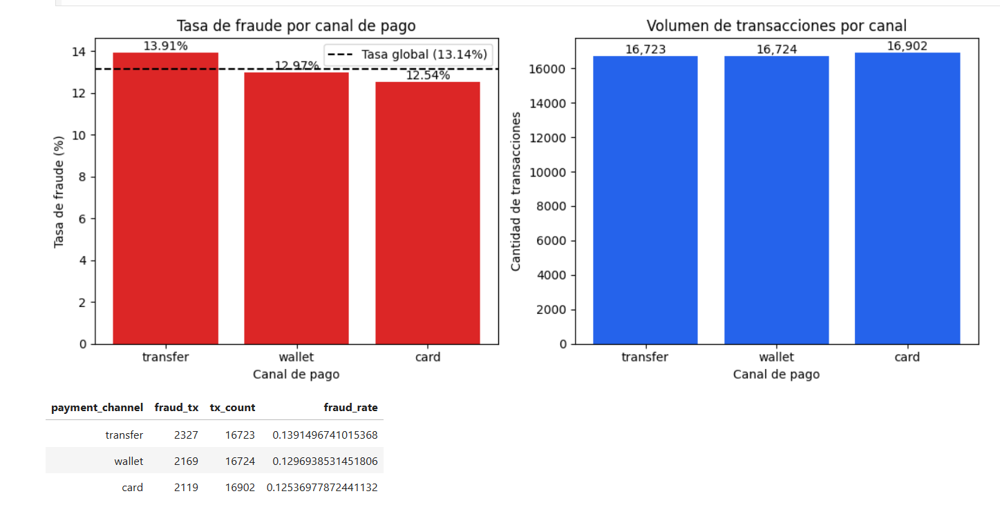
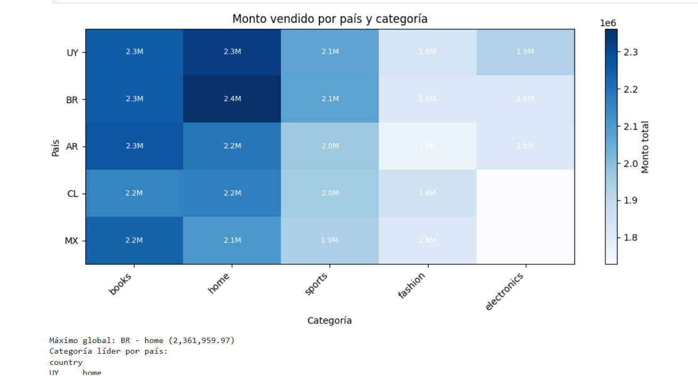
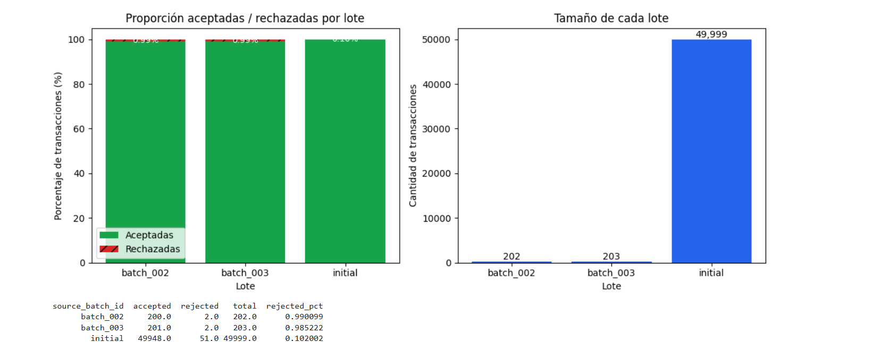

# Práctica 2 — Silver, Gold y orquestación

- **Nombre:** María Belén Peña
- **student_id:** `belu_pena`
- **Escala:** `small`
- **Esquema:** `workspace.bigdata_belu_pena`

## 1. Job de Lakeflow

- **Nombre exacto del Job:**`bigdata_belu_pena_silver_gold`
- **URL del Job:** https://dbc-e781d68e-abac.cloud.databricks.com/jobs/525285604866426?o=7474644315277246
- **Tareas (en orden de dependencia):** ingesta Bronze incremental (`01_ingest_bronze_incremental`) → `build_silver` (`02_build_silver`) → `build_gold` (`03_build_gold`) → `validate` (`04_validate_pipeline`).

**Captura del DAG:**




## 2. Resultados de las ejecuciones

Salida de `pipeline_run_audit` (ordenada por `recorded_at`, horarios UTC):

| Corrida | `job_run_id` | `expected_batch_id` | `silver_rows` | `quarantine_rows` | `gold_rows` | `gold_total_amount` | `idempotence_compared` |
|---|---|---|---:|---:|---:|---:|---|
| 1ª ejecución, batch_002 | 556181266817971 | batch_002 | 50149 | 53 | 598 | 50286183.33 | false |
| 2ª ejecución (reejecución, sin archivo nuevo) | 951250349216170 | batch_002 | 50149 | 53 | 598 | 50286183.33 | true |
| 3ª ejecución, batch_002 | 944154348338115 | batch_002 | 50149 | 53 | 598 | 50286183.33 | true |
| 1ª ejecución, batch_003 | 456827467225548 | batch_003 | 50349 | 55 | 669 | 50431198.33 | false |
| Validación manual de `04` (batch_003) | interactive | batch_003 | 50349 | 55 | 669 | 50431198.33 | true |

- En la reejecución de `batch_002` las métricas quedaron idénticas, y `idempotence_compared` pasó de `false` (primera corrida, sin registro previo) a `true`.
- **Aceptadas y rechazadas de `batch_002`:** 200 aceptadas y 2 rechazadas según `gold_batch_summary` actual. En la primera corrida de `batch_002` eran 201 aceptadas, porque la corrección de la transacción 42 todavía pertenecía a ese lote. Pasó a `batch_003` cuando este llegó con una versión más reciente.

## 3. Por qué `COPY INTO` y `MERGE` resuelven problemas diferentes

- **`COPY INTO` (Bronze) resuelve la ingesta de archivos.** Registra qué archivos ya cargó y no vuelve a cargarlos, así que un archivo nuevo (`batch_003`) entra de forma incremental y reejecutar el Job no duplica lo ya ingerido. Trabaja a nivel de archivo.
- **`MERGE` (Silver) resuelve la actualización de filas por clave de negocio.** Compara cada `transaction_id` con la tabla destino: inserta los nuevos y actualiza los existentes si la versión que llega es más reciente. Trabaja a nivel de fila y es lo que permite aplicar correcciones sin duplicar.

## 4. Visualizaciones y respuestas (`05_visualizacion.ipynb`)

**Consigna 1 — Evolución temporal.**
El día de mayor monto (2026-03-01, 7,310,840.77) coincide con el de mayor cantidad de transacciones (7,236). El ticket promedio de ese día (1,010.34) es casi igual al general (1,001.63, un 0.9 % más). Entonces el pico de monto se explica por mayor volumen de operaciones y no por compras más caras.



**Consigna 2 — Canal y fraude.**
`transfer` tiene la mayor tasa de fraude (13.91 %), seguido de `wallet` (12.97 %) y `card` (12.54 %). Los volúmenes son parecidos (16,723, 16,724 y 16,902), así que la comparación de tasas es sólida. `card` tiene el mayor volumen y la menor tasa: más transacciones no implica más fraude. Las diferencias son de poco más de un punto porcentual.



**Consigna 3 — País y categoría.**
La combinación con mayor monto es Brasil–`home` (2,361,959.97). No hay una categoría dominante en todos los países: `home` lidera en UY, BR y CL, y `books` lidera en AR y MX. A nivel global, `books` es la categoría con mayor monto (11,165,281.86, ejemplo resuelto del notebook), aunque la combinación máxima es BR–`home`. El mapa de calor permite comparar países y categorías a la vez con el monto como intensidad de color, y los valores escritos en cada celda evitan depender solo del color.



**Consigna 4 — Calidad del pipeline.**
La proporción rechazada es 0.10 % en `initial`, 0.99 % en `batch_002` y 0.99 % en `batch_003`; la aceptada, 99.90 %, 99.01 % y 99.01 %. Los lotes nuevos rechazan unas diez veces más en proporción, pero con solo 2 registros por lote, y `initial` es unas 250 veces más grande. La diferencia no es concluyente con tan pocos casos, por eso conviene comparar proporciones y no cantidades absolutas.



<!-- Guardá las capturas como img/consigna1.png … img/consigna4.png (o borrá estas líneas si preferís que se vean en el notebook). -->

## 5. Preguntas de análisis y comprensión

Las tablas están en `workspace.bigdata_belu_pena`.

### Análisis de las tablas

**1. Filas físicas por lote en `bronze_transactions_incremental`.**

```sql
SELECT source_batch_id, COUNT(*) AS filas
FROM workspace.bigdata_belu_pena.bronze_transactions_incremental
GROUP BY source_batch_id ORDER BY source_batch_id;
```
| source_batch_id | filas |
|---|---:|
| batch_002 | 204 |
| batch_003 | 204 |

**2. Aceptadas y rechazadas por lote, reconciliadas con Gold.**
Consultas: `GROUP BY source_batch_id` sobre `silver_transactions` y `silver_transactions_quarantine` (última celda de `02_build_silver`) y `SELECT * FROM gold_batch_summary` (`03_build_gold`).

| Lote | Aceptadas (Silver) | Rechazadas (cuarentena) | `gold_batch_summary` |
|---|---:|---:|---|
| initial | 49,948 | 51 | 49,948 / 51 |
| batch_002 | 200 | 2 | 200 / 2 |
| batch_003 | 201 | 2 | 201 / 2 |

Total: 50,349 aceptadas y 55 rechazadas, igual que `silver_rows` y `quarantine_rows` de la última fila de `pipeline_run_audit`. Los 201 de `batch_003` incluyen la actualización de la transacción 42.

**3. Motivos de rechazo por lote** (`silver_transactions_quarantine`, `GROUP BY source_batch_id, quality_reason`):

| Lote | `INVALID_AMOUNT` | `UNKNOWN_CUSTOMER` |
|---|---:|---:|
| initial | 51 | 0 |
| batch_002 | 1 | 1 |
| batch_003 | 1 | 1 |

Cada lote nuevo tiene exactamente 2 rechazos, uno de cada tipo, lo que coincide con el control `batch_has_controlled_rejections` (≥ 2) de `04_validate_pipeline`, que valida los casos introducidos por el generador. Los 51 de `initial` son importes no numéricos como `N/A`: la práctica 1 contó 52 filas físicas inválidas, y la diferencia de una probablemente se debe a duplicados exactos que Silver colapsa.

**4. Transacción 42.**

```sql
SELECT transaction_id, amount, source_batch_id, updated_at
FROM workspace.bigdata_belu_pena.bronze_transactions_all
WHERE try_cast(transaction_id AS BIGINT) = 42 ORDER BY updated_at;

SELECT transaction_id, amount, source_batch_id, updated_at
FROM workspace.bigdata_belu_pena.silver_transactions WHERE transaction_id = 42;
```

| Tabla | `amount` | `source_batch_id` | `updated_at` |
|---|---:|---|---|
| Bronze | 600.11 | initial | 2026-03-06 02:07:52 |
| Bronze | 1999.99 | batch_002 | 2026-03-10 02:00:00 |
| Bronze | 1999.99 | batch_003 | 2026-03-11 02:00:00 |
| **Silver (vigente)** | **1999.99** | **batch_003** | **2026-03-11 02:00:00** |

Hay 3 versiones en Bronze y queda 1 en Silver: la de `updated_at` más reciente (columna que justifica la elección), con `source_batch_id` como desempate.

**5. Una fila por `transaction_id` en Silver.**

```sql
SELECT COUNT(*) AS filas, COUNT(DISTINCT transaction_id) AS ids
FROM workspace.bigdata_belu_pena.silver_transactions;

SELECT transaction_id, COUNT(*) AS n
FROM workspace.bigdata_belu_pena.silver_transactions
GROUP BY transaction_id HAVING COUNT(*) > 1;
```

Resultado: 50,349 filas y 50,349 ids; la segunda consulta no devuelve filas. La deduplicación habría fallado si `filas > ids` o si la segunda consulta devolviera algún `transaction_id` repetido. Es también el control `silver_no_duplicate_ids` de `04`.

**6. Tasa de rechazo por lote.**

```sql
SELECT source_batch_id, accepted_transactions, rejected_transactions,
       ROUND(rejected_transactions / (accepted_transactions + rejected_transactions) * 100, 3) AS rejected_pct
FROM workspace.bigdata_belu_pena.gold_batch_summary ORDER BY 1;
```

initial: 51 / 49,999 = 0.102 %; batch_002: 2 / 202 = 0.990 %; batch_003: 2 / 203 = 0.985 %. Comparar solo cantidades absolutas no es correcto: `initial` tiene más rechazos solo porque es mucho más grande. Aun con proporciones, hay que ser cautelosos: con 2 rechazos por lote, la diferencia de proporción tiene poco soporte estadístico.

**7. Día de mayor monto y de más transacciones** (`gold_daily_sales`, notebook 05, Consigna 1).

```sql
SELECT sale_date, SUM(total_amount) AS monto, SUM(transaction_count) AS tx
FROM workspace.bigdata_belu_pena.gold_daily_sales
GROUP BY sale_date ORDER BY monto DESC LIMIT 1;   -- repetir con ORDER BY tx DESC
```

El día de mayor monto es 2026-03-01 (7,310,840.77) y el de más transacciones también (7,236). Los máximos coinciden.

**8. Canal con mayor tasa global de fraude.**

```sql
SELECT payment_channel, SUM(fraud_transactions) AS fraude, SUM(transaction_count) AS tx,
       SUM(fraud_transactions) / SUM(transaction_count) AS tasa
FROM workspace.bigdata_belu_pena.gold_daily_sales GROUP BY payment_channel ORDER BY tasa DESC;
```

| Canal | Fraude | Transacciones | Tasa |
|---|---:|---:|---:|
| transfer | 2,327 | 16,723 | 13.91 % |
| wallet | 2,169 | 16,724 | 12.97 % |
| card | 2,119 | 16,902 | 12.54 % |

La tasa global es 6,615 / 50,349 = 13.14 %. No corresponde promediar `fraud_rate` porque es un cociente: cada fila de `gold_daily_sales` tiene un `transaction_count` distinto, y el promedio simple da el mismo peso a una fila de 76 transacciones que a una de 118. Además `fraud_rate` está redondeada a 4 decimales. Hay que sumar numeradores y denominadores y dividir.

**9. País y categoría de mayor monto.**

```sql
SELECT country, category, total_amount FROM (
  SELECT country, category, SUM(total_amount) AS total_amount,
         ROW_NUMBER() OVER (PARTITION BY country ORDER BY SUM(total_amount) DESC) AS rn
  FROM workspace.bigdata_belu_pena.gold_daily_sales GROUP BY country, category
) WHERE rn = 1;
```

La combinación máxima global es BR–`home` (2,361,959.97). Categoría líder por país: UY `home`, BR `home`, AR `books`, CL `home`, MX `books`.

**10. `pipeline_run_audit`, reejecución de `batch_002`.**

```sql
SELECT * FROM workspace.bigdata_belu_pena.pipeline_run_audit
WHERE expected_batch_id = 'batch_002' ORDER BY recorded_at ASC;
```

Las dos primeras filas (1ª y 2ª ejecución) tienen exactamente las mismas métricas: `silver_rows` = 50,149, `quarantine_rows` = 53, `gold_rows` = 598 y `gold_total_amount` = 50,286,183.33. Cambian `job_run_id` y `recorded_at`. La columna `idempotence_compared` demuestra la comparación: es `false` en la primera (no había registro previo del mismo lote) y `true` en la segunda, que se contrastó contra la anterior con un `assert` sobre las cuatro métricas (`04_validate_pipeline`, última celda).

### Interpretación del código y del pipeline

**11. `COPY INTO` en `01_ingest_bronze_incremental`.**
Resuelve la ingesta incremental e idempotente de archivos: carga solo los archivos nuevos del directorio de entrada. Para no cargar dos veces el mismo archivo físico usa el registro de archivos ya ingeridos que mantiene sobre la tabla destino (identifica cada archivo por su ruta y metadatos).
<!-- VERIFICAR contra 01_ingest_bronze_incremental.ipynb y citar la celda. -->

**12. `UNION ALL` en `bronze_transactions_all`.**
Bronze conserva todo lo recibido, incluidas las versiones distintas de una misma transacción y los duplicados, como evidencia de lo que llegó de cada origen. Eliminar duplicados ahí perdería ese historial (por ejemplo las tres versiones de la transacción 42). Los duplicados de negocio se resuelven en Silver (`02_build_silver`, celda de `dropDuplicates(raw_columns)` y `row_number()` por `_record_key`), que es la capa donde se limpian los datos, no antes.

**13. `source_batch_id='initial'` y `event_ts` como `updated_at`.**
La carga original no traía un `updated_at`, así que se usa `event_ts` para tener una marca de tiempo comparable con la de las correcciones, y `'initial'` identifica el lote de origen. Para la transacción 42: la versión inicial queda con `updated_at` = 2026-03-06 y las correcciones traen fechas posteriores (03-10 y 03-11), por lo que ganan en el `row_number` de Silver y en el `MERGE`. Silver muestra en su historial una `UPDATE` real en la versión 4 (`numTargetRowsUpdated` = 1), cuando `batch_003` actualizó la fila de la transacción 42.
<!-- VERIFICAR el "por qué" de 'initial' contra el notebook 01. -->

**14. `try_cast` frente a `cast`.**
Con un importe como `N/A`, un `cast` convencional lanza un error y aborta toda la consulta y el Job (Databricks serverless usa modo ANSI por defecto). `try_cast` devuelve `NULL` en lugar de fallar, de modo que el registro puede etiquetarse `INVALID_AMOUNT` y enviarse a cuarentena sin romper el pipeline. Es el mismo criterio del diagnóstico de calidad de la práctica 1 (`try_cast(amount AS DECIMAL(12,2)) IS NULL`).
<!-- VERIFICAR contra quality_rules.py. -->

**15. Una única `quality_reason` por registro.**
Si un registro viola más de una regla, se le asigna solo la causa de la primera condición que se cumple (la cadena de condiciones se evalúa en orden), así que el orden define cuál queda registrada y el resto no se informa. En cuarentena, el `MERGE` usa `transaction_id`, `source_batch_id` y `quality_reason` como clave.
<!-- VERIFICAR contra quality_rules.py (add_quality_reason) y citar el orden real de las reglas. -->

**16. `_record_key` y `row_number`** (`02_build_silver`, celda de `raw_columns`).
`_record_key` es el `transaction_id` convertido a texto; si no se puede convertir a número, es el SHA-256 de todas las columnas crudas concatenadas, con `<NULL>` para los nulos. Se usa en `row_number()` particionado por `_record_key` y ordenado por `updated_at` descendente y luego `source_batch_id` descendente, y se conserva `_rn = 1`, la versión más reciente. El hash cubre el caso del `transaction_id` no convertible: sin él todas esas filas compartirían clave `NULL` y colapsarían en una sola. Con el hash, los registros inválidos distintos se mantienen separados y los duplicados exactos se unifican.

**17. Cláusulas del `MERGE` de `silver_transactions`.**
`WHEN MATCHED AND s.updated_at > t.updated_at THEN UPDATE SET *` actualiza una fila existente solo si la versión nueva es estrictamente más reciente. `WHEN NOT MATCHED THEN INSERT *` inserta los `transaction_id` que todavía no existen. El historial lo confirma: la v1 insertó 50,149 filas; las reejecuciones (v2, v3, v5) no movieron ninguna; la v4 insertó 200 y actualizó 1.

**18. Gold se reconstruye, Silver usa `MERGE`.**
Gold usa `CREATE OR REPLACE TABLE ... AS SELECT` desde Silver (`03_build_gold`).
- *Gold, ventaja:* es simple y determinista, y reejecutar da siempre el mismo resultado.
- *Gold, limitación:* recalcula todo en cada corrida, con un costo que crece con el volumen.
- *Silver, ventaja:* es incremental y aplica correcciones sin tocar el resto de las filas.
- *Silver, limitación:* es más complejo y depende de una buena clave y de `updated_at`; con el `>` estricto, una versión con igual o menor `updated_at` se ignora.

**19. `expected_batch_id` no participa en la detección del archivo nuevo.**
`batch_003` lo descubre `COPY INTO` en la tarea de ingesta, que carga los archivos nuevos del directorio sin mirar el parámetro. `expected_batch_id` solo se lee en `04_validate_pipeline`, donde define qué lote comprobar (`bronze_batch_rows`, `silver_batch_rows`, `rejected_batch_rows`, la corrección de la transacción 42) y contra qué corrida previa comparar en `pipeline_run_audit`. En `02` y `03` el widget está declarado pero no se usa.

**20. Si `build_silver` falla.**
`build_gold` depende de `build_silver`, y `validate` depende de `build_gold`. Si Silver falla, esas tareas no se ejecutan y quedan como "Upstream failed". Así no se publican tablas Gold ni se valida sobre datos incompletos. Hay además una defensa en el código: `03` y `04` hacen `assert` de que existan las tablas de la etapa anterior ("Falta {name}. Ejecutá la tarea 02."). Confirmar con la vista del DAG del Job.
