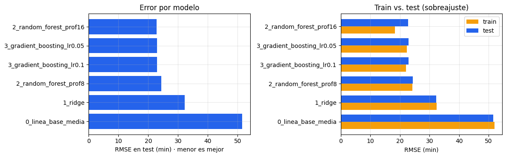

# Trabajo Práctico Final — Big Data y MLOps

- **Estudiante:** María Belén Peña
- **Variante:** 2 — Ejecución
- **Opción:** B — Experimentación y comparación de modelos con MLflow

## Objetivo

Predecir **cuántos minutos tarda una entrega** (`Delivery_Time`) a partir de datos conocidos al momento del pedido (repartidor, ubicación, clima, tráfico, vehículo y hora), y comparar varios modelos de regresión con **MLflow** para elegir el mejor de forma justificada.

Un modelo así sirve en logística para prometer horarios de entrega más realistas y para detectar qué factores demoran más los pedidos.

## Contenido de la carpeta

```text
tp-final/
├── README.md                          Este documento
├── 01_exploracion_y_limpieza.ipynb    Exploración, limpieza, variables nuevas y partición temporal
├── 02_experimentos_mlflow.ipynb       Entrenamiento de 6 configuraciones, registro en MLflow y comparación
└── img/
    └── comparacion_runs.png           Error de cada modelo y comparación train vs. test
```

Los notebooks se subieron con sus salidas, como evidencia de la ejecución. Los datos no se versionan en el repositorio (ver *Datos*).

## Datos

- **Fuente:** *Amazon Delivery Dataset*, publicado en Kaggle (archivo `amazon_delivery.csv`). Link: [https://www.kaggle.com/datasets/sujalsuthar/amazon-delivery-dataset/code].
- **Contenido:** 43.739 entregas realizadas en India entre el 11/02/2022 y el 06/04/2022, con 16 columnas: datos del repartidor (edad y calificación), coordenadas de la tienda y del destino, fecha y hora del pedido y de la recogida, clima, tráfico, vehículo, zona, categoría del producto y el tiempo de entrega en minutos.
- **Variable objetivo:** `Delivery_Time` (de 10 a 270 minutos, promedio de 125).
- **Por qué este dataset:** es un único archivo de tamaño manejable, tiene una variable objetivo numérica clara, mezcla variables numéricas y categóricas, y presenta problemas de calidad reales para resolver. Además está relacionado con logística y cadena de suministro.
- No contiene datos personales: los repartidores no están identificados.

## Qué se hizo

### 1. Exploración y limpieza (notebook 01)

Problemas de calidad detectados y cómo se resolvieron (no se eliminó ninguna fila):

| Problema | Filas afectadas | Tratamiento |
|---|---|---|
| Texto con espacios al final (`'Low '`, `'Jam '`) y `Metropolitian` mal escrito | casi todas | Se eliminan los espacios y se corrige el nombre |
| Tráfico `'NaN'` como texto, clima faltante | 91 | Pasan a nulo real; se imputan dentro del Pipeline |
| Hora del pedido mal formada | 91 | Nulo; se imputa |
| Calificación del repartidor faltante o mayor a 5 | 54 faltantes y 53 con valor imposible | Los imposibles pasan a nulo; se imputa |
| Repartidores menores de 18 años | 38 | Pasan a nulo; se imputa |
| Tiendas con latitud o longitud negativa (están en India) | 188 | Se toma el valor absoluto |
| Tiendas con coordenadas (0, 0) | 3.505 | La distancia queda nula y se agrega la marca `coords_invalidas` |

**Variables nuevas:** `distancia_km` (en línea recta, fórmula de Haversine), `hora_pedido`, `dia_semana` y `demora_recogida_min` (minutos entre el pedido y la recogida; se suman 24 horas cuando el pedido cruza la medianoche).

**Relación con el objetivo** (correlación con `Delivery_Time`): calificación del repartidor −0,29, distancia 0,28, edad del repartidor 0,26 y hora del pedido 0,16. El día de la semana y la demora de recogida casi no se relacionan.

### 2. Partición y evaluación

- **Partición temporal**, como en un sistema real: se entrena con el pasado y se evalúa con lo que viene después. `train`: pedidos hasta el 29/03/2022 (35.620 filas); `test`: pedidos posteriores (8.119 filas). Es la misma para todos los modelos.
- Las imputaciones y la codificación están **dentro del Pipeline** de cada modelo, para que se ajusten sólo con `train` y no filtren información del test.
- **Métricas:** RMSE (principal, penaliza los errores grandes), MAE (error promedio en minutos) y R², en train y en test. Comparar ambos permite ver el sobreajuste.
- Misma semilla (`random_state=42`) en todos los runs.

### 3. Modelos y registro en MLflow (notebook 02)

Se entrenaron 6 configuraciones comparables. Cada una es un *run* del experimento `tp_final_delivery`, con sus parámetros (modelo, hiperparámetros, versión de la tabla y semilla), sus métricas de train y de test, y sus artefactos: gráfico de real contra predicho, distribución del error, importancia de variables por permutación y el modelo con su firma.

| Configuración | Qué es |
|---|---|
| `0_linea_base_media` | Predice siempre el promedio de `train` (piso de comparación) |
| `1_ridge` | Regresión lineal con regularización |
| `2_random_forest_prof8` y `2_random_forest_prof16` | Random forest de 150 árboles, con profundidad máxima 8 y 16 |
| `3_gradient_boosting_lr0.1` y `3_gradient_boosting_lr0.05` | Gradient boosting (`HistGradientBoostingRegressor`) con dos tasas de aprendizaje |

## Resultados

Ordenados por RMSE de test (menor es mejor):

| run | train_rmse | test_rmse | test_mae | test_r2 | brecha_train_test |
|---|---|---|---|---|---|
| 2_random_forest_prof16 | 18.263 | 22.832 | 17.628 | 0.804 | 4.57 |
| 3_gradient_boosting_lr0.05 | 22.376 | 22.887 | 17.784 | 0.803 | 0.511 |
| 3_gradient_boosting_lr0.1 | 22.108 | 22.904 | 17.804 | 0.803 | 0.795 |
| 2_random_forest_prof8 | 24.266 | 24.352 | 18.759 | 0.777 | 0.087 |
| 1_ridge | 32.481 | 32.24 | 25.354 | 0.609 | -0.241 |
| 0_linea_base_media | 51.992 | 51.579 | 40.962 | -0.0 | -0.413 |



### Selección del mejor modelo

- Los modelos de árboles superan claramente a la regresión lineal y a la línea de base. La mejora del RMSE del mejor modelo respecto de la línea de base es de 55,7 %.
- **Elegido: `2_random_forest_prof16`**, con el menor RMSE (22,83 min) y MAE (17,63 min) de test, y un R² de 0,80. Un error promedio de unos 18 minutos sobre una entrega típica de 125 minutos equivale a un 14 %.
- Los dos boosting quedan prácticamente empatados con el random forest (diferencia de 0,05 a 0,07 minutos de RMSE, que no es relevante) y **generalizan mejor**: su brecha entre train y test es de 0,5 a 0,8 minutos, contra 4,6 del random forest de profundidad 16, que muestra algo de sobreajuste. Si se priorizara la estabilidad, el boosting con tasa de aprendizaje 0,05 sería una alternativa igualmente defendible.
- La regresión lineal queda lejos (RMSE 32,2) porque no capta combinaciones entre variables. Subir la profundidad del random forest de 8 a 16 mejoró el error de test de 24,4 a 22,8 minutos.

### Variables más importantes (modelo elegido)

Importancia por permutación sobre el test (aumento del RMSE, en minutos, al desordenar la variable):

| variable | importancia |
|---|---|
| Category | 21.60 |
| Weather | 14.55 |
| Traffic | 13.63 |
| Agent_Rating | 12.33 |
| distancia_km | 12.18 |
| Agent_Age | 9.29 |
| Vehicle | 3.13 |
| Area | 0.45 |
| coords_invalidas | 0.21 |
| hora_pedido | 0.16 |
| dia_semana | −0.00 |
| demora_recogida_min | −0.02 |

Clima, tráfico, calificación del repartidor y distancia tienen sentido para el negocio. En cambio, que la **categoría del producto** sea la variable más importante no tiene una explicación operativa evidente, y sugiere que el dataset puede tener patrones poco realistas (por ejemplo, ser sintético). Se informa como hallazgo y como limitación.

### Dónde se equivoca más el modelo (error absoluto medio en test)

- **Tráfico:** 14,7 min con tráfico bajo, 18,2 con medio, 18,7 con alto y 20,1 con embotellamiento; 23,5 cuando falta el dato.
- **Zona:** 25,2 min en `Semi-Urban` (la zona con menos pedidos, 152 en todo el dataset), contra unos 17,6 en las zonas metropolitana y urbana.
- **Coordenadas inválidas:** 22,6 min en los 510 pedidos de test sin distancia, contra 17,3 en el resto.

## Limitaciones

- El período es corto (unas 8 semanas, de febrero a abril de 2022), por lo que el modelo no captura estacionalidad ni efectos de fechas especiales.
- El 8 % de los pedidos no tiene distancia por coordenadas inválidas en la tienda, y esos pedidos tienen un error mayor.
- No se conoce el tráfico real minuto a minuto: la variable `Traffic` es una categoría general y el tiempo de entrega tiene un componente aleatorio que un modelo no explica (R² de 0,80, no de 1).
- La importancia de la categoría del producto sugiere patrones artificiales, así que los resultados pueden no generalizarse a entregas reales.
- No se hizo ajuste sistemático de hiperparámetros: se compararon dos valores por familia de modelos, y la comparación entre el random forest y el boosting es muy ajustada.
- La partición temporal usa un único corte; no se validó con varios cortes sucesivos.

## Cómo reproducir

1. Descargar `amazon_delivery.csv` desde Kaggle (ver *Datos*) y descomprimirlo.
2. En Databricks (Free Edition, compute serverless), crear en el catálogo `workspace` el esquema `tp_final_belu` y, dentro de él, un volumen *managed* llamado `datos`. Subir el CSV al volumen (**Catalog → Upload to this volume**).
3. Importar a una carpeta del Workspace los dos notebooks de esta carpeta.
4. Ejecutar `01_exploracion_y_limpieza.ipynb` de arriba hacia abajo. Si la ruta del CSV es distinta de `/Volumes/workspace/tp_final_belu/datos/amazon_delivery.csv`, ajustar la variable `RUTA`. Crea la tabla `workspace.tp_final_belu.delivery_features`. Si da error de que el esquema no existe, ejecutar antes `CREATE SCHEMA IF NOT EXISTS workspace.tp_final_belu`.
5. Ejecutar `02_experimentos_mlflow.ipynb` de arriba hacia abajo, **una sola vez** (cada ejecución agrega runs nuevos al experimento). Los runs quedan en el experimento `/Users/<usuario>/tp_final_delivery`.

Librerías: pandas, NumPy, matplotlib, scikit-learn y MLflow, que vienen instaladas en el compute serverless. No se incluyen credenciales ni datos sensibles.

## Fuentes y referencias

- *Amazon Delivery Dataset*, Kaggle.
- Documentación de [MLflow](https://mlflow.org/docs/latest/index.html) y de [scikit-learn](https://scikit-learn.org/stable/user_guide.html).
- Material de la cursada *Herramientas de Big Data* (ITBA), práctica 5 (MLOps con MLflow).
